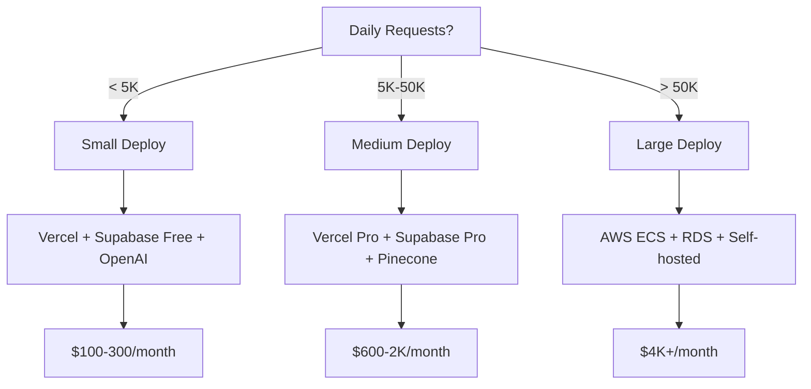

# Infrastructure Sizing Calculator

## Request Volume Modeling

### 1. Baseline Metrics Collection

**Data Points Needed:**
```yaml
user_activity:
  - Daily Active Users (DAU)
  - Average sessions per user per day
  - Average requests per session
  - Peak hour multiplier (typical: 3-5x average)

ai_workload:
  - Average prompt length (tokens)
  - Average completion length (tokens)
  - Context window size (for RAG: embeddings count)
  - Response time SLA (p95 latency target)
```

### 2. Calculations

**Daily Request Volume**
```python
daily_requests = DAU × sessions_per_user × requests_per_session

# Example:
# 1,000 DAU × 3 sessions × 5 requests = 15,000 requests/day
```

**Peak QPS (Queries Per Second)**
```python
average_qps = daily_requests / 86400  # seconds in a day
peak_qps = average_qps × peak_hour_multiplier

# Example:
# 15,000 / 86400 = 0.17 avg QPS
# 0.17 × 4 = 0.68 peak QPS
```

**LLM Cost Estimation**
```python
# OpenAI GPT-4 pricing (Jan 2025):
# Input: $0.01 per 1K tokens
# Output: $0.03 per 1K tokens

daily_input_tokens = daily_requests × avg_prompt_tokens
daily_output_tokens = daily_requests × avg_completion_tokens

input_cost = (daily_input_tokens / 1000) × 0.01
output_cost = (daily_output_tokens / 1000) × 0.03

monthly_llm_cost = (input_cost + output_cost) × 30

# Example (500 input, 300 output per request, 15K requests/day):
# Input: (15,000 × 500 / 1000) × $0.01 = $75/day
# Output: (15,000 × 300 / 1000) × $0.03 = $135/day
# Monthly: ($75 + $135) × 30 = $6,300/month
```

### 3. Infrastructure Sizing Tables

**API Server Sizing (FastAPI / Node.js)**

| Peak QPS | Concurrent Connections | Instance Type | Count | Monthly Cost |
|----------|------------------------|---------------|-------|--------------|
| < 1 | < 100 | Vercel Serverless | N/A | $0-20 |
| 1-10 | 100-1,000 | AWS t3.small | 2 | ~$30 |
| 10-50 | 1,000-5,000 | AWS t3.medium | 2-4 | ~$120 |
| 50-200 | 5,000-20,000 | AWS c6i.large | 4-8 | ~$480 |
| 200+ | 20,000+ | AWS c6i.xlarge | 8+ | $1,000+ |

**Database Sizing (PostgreSQL)**

| Rows | Storage | IOPS | Instance Type | Monthly Cost |
|------|---------|------|---------------|--------------|
| < 1M | < 10GB | < 1K | Supabase Free | $0 |
| 1M-10M | 10-50GB | 1K-5K | Supabase Pro | $25 |
| 10M-100M | 50-200GB | 5K-10K | RDS db.t3.large | ~$150 |
| 100M+ | 200GB+ | 10K+ | RDS db.r6g.xlarge | $350+ |

**Vector Database Sizing (Pinecone / Weaviate)**

| Vectors | Dimensions | Queries/sec | Service | Monthly Cost |
|---------|------------|-------------|---------|--------------|
| < 100K | 1536 | < 10 | Pinecone Starter | $0 (free tier) |
| 100K-1M | 1536 | 10-50 | Pinecone Starter | $70 |
| 1M-10M | 1536 | 50-200 | Pinecone Standard | $500 |
| 10M+ | 1536 | 200+ | Self-hosted Weaviate | $300+ (compute only) |

### 4. Latency Budgeting

**Target: p95 < 2s end-to-end**

```yaml
latency_breakdown:
  network_overhead: 100ms   # Client ↔ CDN ↔ API
  auth_check: 50ms          # JWT validation
  database_query: 200ms     # User context retrieval
  vector_search: 300ms      # RAG: find relevant docs
  llm_inference: 1,000ms    # OpenAI API call
  response_assembly: 50ms   # Format JSON response
  
total_p95: 1,700ms          # ✅ Under 2s target
buffer: 300ms               # For variance/retries
```

**Optimization Strategies:**
```yaml
if_p95_exceeds_target:
  - Cache frequent queries (Redis, 10ms lookup)
  - Pre-compute embeddings (avoid on-demand)
  - Use streaming responses (perceived latency reduction)
  - Implement request coalescing (batch similar queries)
  - Upgrade LLM tier (GPT-4 Turbo faster than GPT-4)
```

### 5. Auto-Scaling Rules

**Horizontal Scaling Triggers**
```yaml
scale_up:
  - CPU > 70% for 2 minutes
  - Memory > 80% for 2 minutes
  - Request queue depth > 100
  - p95 latency > 2.5s for 5 minutes

scale_down:
  - CPU < 30% for 10 minutes
  - Memory < 50% for 10 minutes
  - Request queue depth < 20
  - All metrics below threshold for 15 minutes
```

**Cost-Optimized Scaling**
```python
# Example: Vercel Functions (serverless)
# Cost: $0.00006 per GB-second

monthly_invocations = daily_requests × 30
avg_duration_ms = 800  # Including cold starts
avg_memory_mb = 512

gb_seconds = (monthly_invocations × avg_duration_ms / 1000) × (avg_memory_mb / 1024)
cost = gb_seconds × 0.00006

# Example: 15,000 req/day × 30 = 450,000/month
# (450,000 × 0.8) × 0.5 = 180,000 GB-seconds
# 180,000 × $0.00006 = $10.80/month (compute only)
```

### 6. Data Storage Estimation

**User Data Growth**
```python
new_users_per_month = 1000
avg_user_data_kb = 50  # Profile, preferences, history

monthly_growth_gb = (new_users_per_month × avg_user_data_kb) / 1024 / 1024
yearly_growth_gb = monthly_growth_gb × 12

# Example:
# (1,000 × 50) / 1024 / 1024 = 0.048 GB/month
# 0.048 × 12 = 0.58 GB/year
```

**Vector Embeddings Storage**
```python
# OpenAI text-embedding-ada-002: 1536 dimensions × 4 bytes (float32)
embedding_size_kb = (1536 × 4) / 1024  # 6 KB per document

documents = 10000
total_vector_storage_gb = (documents × embedding_size_kb) / 1024 / 1024

# Example:
# 10,000 docs × 6 KB = 60 MB (negligible)
# Pinecone indexes this + metadata → ~200 MB total
```

### 7. Sizing Decision Tree



### 8. Capacity Planning Worksheet

**Client:** ___________________________  
**Use Case:** ___________________________  
**Date:** ___________________________

| Metric | Value | Source |
|--------|-------|--------|
| Expected DAU | _______ | Client estimate |
| Sessions per user | _______ | Industry avg or client data |
| Requests per session | _______ | Workflow analysis |
| Peak hour multiplier | _______ | 3-5x for B2B, 10x for B2C |
| Avg prompt tokens | _______ | Sample prompts |
| Avg completion tokens | _______ | Sample responses |
| SLA latency (p95) | _______ | Client requirement |

**Calculated Values:**
- Daily requests: _______
- Peak QPS: _______
- Monthly LLM cost: $_______
- Recommended tier: Small / Medium / Large

**Infrastructure Recommendation:**
- [ ] Hosting: _______________________
- [ ] Database: _______________________
- [ ] Vector DB: _______________________
- [ ] Estimated monthly total: $_______

---

**Notes:**
- Always add 30% buffer for unexpected spikes
- Review actual usage after 30 days, adjust sizing
- Set up cost alerts at 80% of budget
- Plan for 2x scale headroom (allows doubling without re-architecture)
