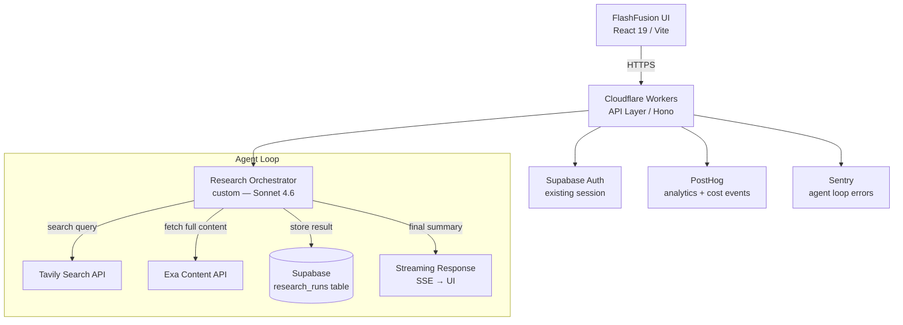

# Example Output: Personal Build — FlashFusion Research Agent

**Context:** Adding a research agent to FlashFusion. It should search the web, summarize findings, and store results. No client, no compliance requirements. Existing stack: Supabase, Cloudflare, React 19/Vite, PostHog.

**Output type used:** Architecture Diagram (`templates/architecture-diagram.md`) + component rationale

---

## FlashFusion Research Agent — Architecture Decision

### Architecture Diagram



### Component Decisions

| Component | Choice | Rationale |
|-----------|--------|-----------|
| LLM | Claude Sonnet 4.6 | Best tool-call reliability for multi-step agent loops; 200K context window handles long research sessions; already default model in FlashFusion |
| Backend | Cloudflare Workers + Hono | Already in stack; sub-50ms global edge; Cloudflare AI bindings available if needed later |
| Search | Tavily Search API | Purpose-built for LLM agents; returns clean structured results, not raw HTML; $0 for low volume |
| Content fetch | Exa Content API | Full article extraction for Tavily results that need depth; use selectively (adds latency + cost) |
| Storage | Supabase (existing) | Already provisioned; `research_runs` table is a 10-minute schema addition |
| Auth | Supabase Auth (existing) | No new auth layer needed |
| Observability | PostHog + Sentry (existing) | Track agent loop steps and per-run cost in PostHog; Sentry for tool-call failures |

### Key Design Decisions

- **No routing architecture.** Single-agent, low-volume (personal tool). Overhead of a routing classifier isn't justified. Sonnet 4.6 for all agent steps.
- **No vector DB.** Research results stored as JSON in Supabase `research_runs`. Semantic search across past runs is a Phase 2 consideration; pgvector can be added to existing Supabase instance if needed.
- **Custom orchestrator over LangChain.** FlashFusion already has a custom LLM abstraction layer. Dropping LangChain in adds a dependency for what is essentially a 3-step loop: search → fetch → summarize. Keep it in the existing pattern.
- **SSE streaming, not WebSockets.** One-way flow from agent to UI. SSE is simpler, works on Cloudflare Workers without Durable Objects.
- **Tavily first, Exa on demand.** Tavily covers 90% of research queries. Exa triggered only when Tavily result is a summary/paywall and full content is needed. Keeps cost predictable.

### Schema Addition (Supabase)

```sql
create table research_runs (
  id uuid primary key default gen_random_uuid(),
  user_id uuid references auth.users not null,
  query text not null,
  sources jsonb,           -- array of {url, title, snippet}
  summary text,
  model text default 'claude-sonnet-4-6',
  tokens_used integer,
  cost_usd numeric(8,6),
  created_at timestamptz default now()
);

alter table research_runs enable row level security;
create policy "users see own runs" on research_runs
  for all using (auth.uid() = user_id);
```

### Estimated Monthly Cost

At personal-use scale (~50 research runs/month, avg 8 tool calls/run):

| Component | Est. Monthly |
|-----------|-------------|
| Sonnet 4.6 (50 runs × ~8K tokens avg) | ~$3–6 |
| Tavily Search (50 runs × 5 searches) | ~$0 (free tier covers 1K/month) |
| Exa Content (selective, ~25 fetches/month) | ~$0 (free tier) |
| Cloudflare Workers | $0 (free tier) |
| Supabase (existing Pro) | $0 added |
| **Total added cost** | **~$3–6/month** |

### Implementation Notes

1. Add `TAVILY_API_KEY` and `EXA_API_KEY` to Cloudflare Workers env vars (server-side only, never bundled)
2. Research orchestrator is a single Cloudflare Worker with a `while (toolCallsRemaining)` loop — max 10 tool calls per run to prevent runaway agents
3. Track `cost_usd` per run in PostHog as a custom event: `research_agent_run_complete` with cost + token properties
4. Sentry breadcrumbs on each tool call step — makes agent debugging tractable
