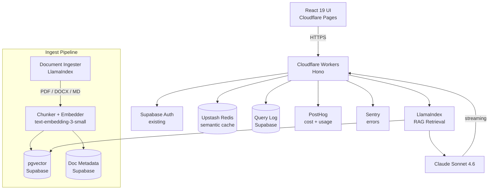

# Example Output: Solo Build — Personal Knowledge Base

**Context:** Personal tool. Ingest notes from Obsidian, Notion exports, saved articles, and research PDFs. Query them conversationally. Solo user. No compliance requirements. Existing stack: Supabase, Cloudflare, PostHog. Budget flexible but not unlimited.

**Output type used:** Spec Doc (`templates/spec-doc.md`)
**Sizing tool used:** `scripts/sizing_calc.py` with solo-user inputs

---

# AI Solution Architecture: Personal Knowledge Base

**Date:** 2026-05-14
**Version:** 1.0
**Author:** Kyle Rosebrook

---

## Problem Statement

Notes, research docs, and saved articles are scattered across Obsidian, Notion, and a /downloads folder. Finding anything requires remembering which tool it's in, then searching manually. The goal: a single conversational interface that answers questions across all of it — "what did I read about prompt caching last month?" returns the right answer regardless of where it was saved.

## Proposed Solution

RAG pipeline over a unified document corpus, running on existing Supabase + Cloudflare stack, powered by Claude Sonnet 4.6. Single-user, so no routing architecture — the added complexity isn't justified at solo scale.

**Monthly Infrastructure Cost:** ~$30–60/month added to existing stack

---

## Architecture Overview

### Component Stack

| Layer | Choice | Rationale |
|-------|--------|-----------|
| LLM | Claude Sonnet 4.6 | Best retrieval accuracy; long context handles chunked docs well; already in stack |
| Application layer | Cloudflare Workers + Hono | Already in use; zero added compute cost at solo scale |
| Orchestration | LlamaIndex | Document-heavy RAG; strong PDF/DOCX parsing; hybrid search built-in |
| Vector DB | pgvector on Supabase | Solo scale (~50K vectors max); zero added cost; already provisioned |
| Relational DB | Supabase (existing) | Document metadata, ingest history, query log |
| Auth | Supabase Auth (existing) | Single user — no new auth work needed |
| Hosting | Cloudflare Pages (existing) | React 19 frontend already there |
| Cache | Upstash Redis | Semantic cache on repeated queries; minimal cost at solo volume |
| Observability | PostHog (existing) + Sentry | Cost-per-query tracking; error alerts |

### Architecture Diagram

### Component Decisions

| Component | Choice | Rationale |
|-----------|--------|-----------|
| LLM | Sonnet 4.6 (no routing) | Solo use, ~50 queries/day — routing overhead not justified |
| Vector DB | pgvector | ~50K vectors max (500 docs × 100 chunks); well inside pgvector envelope; $0 added |
| Embeddings | text-embedding-3-small | 1536-dim, cheap ($0.02/1M tokens), fast; adequate for personal knowledge |
| Orchestration | LlamaIndex | Better PDF/DOCX parsing than LangChain; hybrid search (vector + BM25) built in |
| Cache | Semantic cache on Upstash | Same question rephrased slightly → cache hit; saves ~30% of LLM calls at steady state |

### Key Design Decisions

- **No routing.** Single user, ~50 queries/day. Haiku classifier adds latency and complexity for essentially zero cost savings.
- **pgvector over Pinecone.** 500 documents × 100 chunks = 50K vectors. Well under the 2M pgvector threshold, and it's already provisioned.
- **Hybrid search (vector + BM25).** Pure semantic search misses exact technical terms ("HNSW index," "text-embedding-3-small"). BM25 fallback catches them.
- **Ingest pipeline is async, not real-time.** Documents ingested via a scheduled job or manual trigger — not on-the-fly during queries. Keeps query latency clean.
- **No multi-tenant anything.** This is a single-user system. RLS is set but there's only one user ID. No RBAC needed.

---

## Infrastructure Sizing

**Solo-user inputs:**

| Metric | Value | Basis |
|--------|-------|-------|
| Daily Active Users | 1 | Solo |
| Queries per day | ~50 | Estimated heavy usage |
| Peak QPS | ~0.001 | Irrelevant at this scale |
| Documents at launch | ~500 | Obsidian vault + saved articles |
| Expected growth | +100 docs/month | Ongoing note-taking |
| Vector count (launch) | ~50K | 500 docs × avg 100 chunks |
| Vector count (12-month) | ~170K | 1,700 docs × 100 chunks |

**Sizing Tier:** Small (well below 5K req/day threshold)

**Cost Breakdown:**

| Component | Specification | Monthly Cost |
|-----------|---------------|--------------|
| Compute | Cloudflare Workers (existing) | $0 added |
| Database | Supabase Pro (existing) | $0 added |
| Vector DB | pgvector on Supabase (included) | $0 added |
| LLM API | Sonnet 4.6, ~50 queries/day, ~1K tokens avg | $20–45 |
| Embeddings | text-embedding-3-small, ingest + re-index | ~$1 |
| Cache | Upstash Redis (semantic cache, solo volume) | ~$2–5 |
| Observability | PostHog + Sentry (existing free tiers) | $0 added |
| **Total added** | | **~$23–51/month** |

**AI FinOps Targets:**
- Cost per query: < $0.02 (50 queries/day × $0.02 = $1/day ceiling)
- Semantic cache hit rate: > 25% at 30-day steady state
- Re-index cost: < $5/month (text-embedding-3-small is cheap)

---

## Security

**Data Classification:** Personal / Private (notes, research, unpublished work)

No compliance frameworks in scope. Standard controls:

| Control | Implementation |
|---------|---------------|
| Auth | Supabase Auth; single user session; 24h expiry |
| Secrets | All API keys in Cloudflare env vars; never bundled in Workers script |
| Data at rest | Supabase encryption-at-rest (default) |
| Data in transit | TLS 1.3 (Cloudflare default) |
| Prompt injection | System prompt isolation; max token guardrail on user input |
| Backup | Supabase daily backups (Pro tier) — covers vector store + metadata |

---

## Build Phases

### Phase 1: Ingest Pipeline (Days 1–3)
- [ ] `documents` table + `document_chunks` table in Supabase with pgvector
- [ ] LlamaIndex document loader: PDF, DOCX, Markdown, plain text
- [ ] Chunking strategy: 512 tokens, 50-token overlap
- [ ] Embedding pipeline: text-embedding-3-small → pgvector upsert
- [ ] CLI ingest script: `python ingest.py --dir ./vault`
- Acceptance: 500 docs ingested, embeddings verified in Supabase

### Phase 2: Query API (Days 4–6)
- [ ] Cloudflare Worker: POST `/api/query` → LlamaIndex → Sonnet 4.6 → SSE stream
- [ ] Hybrid search: pgvector cosine similarity + BM25 keyword fallback
- [ ] Semantic cache: Upstash Redis, 24h TTL, cosine threshold 0.95
- [ ] Query log: save query + response + tokens + cost to Supabase
- Acceptance: 20-query accuracy test, target >80% relevant retrieval

### Phase 3: UI (Days 7–10)
- [ ] React 19 chat interface on Cloudflare Pages
- [ ] Streaming response display (SSE → ReadableStream)
- [ ] Source citations: show top 3 source documents per answer
- [ ] Query history: pull from Supabase query log
- Acceptance: end-to-end query working in browser with citations

### Phase 4: Sync + Polish (Days 11–14)
- [ ] Obsidian vault sync: watch for new/modified files, re-ingest delta
- [ ] Notion export parser: handle Notion markdown quirks
- [ ] PostHog cost event: `kb_query_complete` with tokens + cost properties
- [ ] Sentry error tracking on ingest failures and LLM errors
- Acceptance: new notes appear in search within 1 hour of save

---

## Risks

| Risk | Likelihood | Impact | Mitigation |
|------|------------|--------|------------|
| Chunking strategy loses context across chunk boundaries | Medium | Medium | 50-token overlap; test on known multi-page docs |
| Retrieval misses technical terms (exact match needed) | Medium | Medium | BM25 hybrid search covers this; tune weight |
| Obsidian vault has inconsistent formatting | High | Low | Pre-processing step normalizes headers and frontmatter |
| LLM cost higher than estimated (verbose queries) | Low | Low | PostHog alert if daily cost > $2; semantic cache reduces repeat cost |

---

## Success Criteria

| Metric | Target |
|--------|--------|
| Query answer relevance | > 80% on 20-question manual eval at 30 days |
| p95 query latency | < 4s (RAG + Sonnet streaming) |
| Semantic cache hit rate | > 25% at steady state |
| Monthly LLM cost | < $50 |
| New doc → searchable | < 1 hour |
